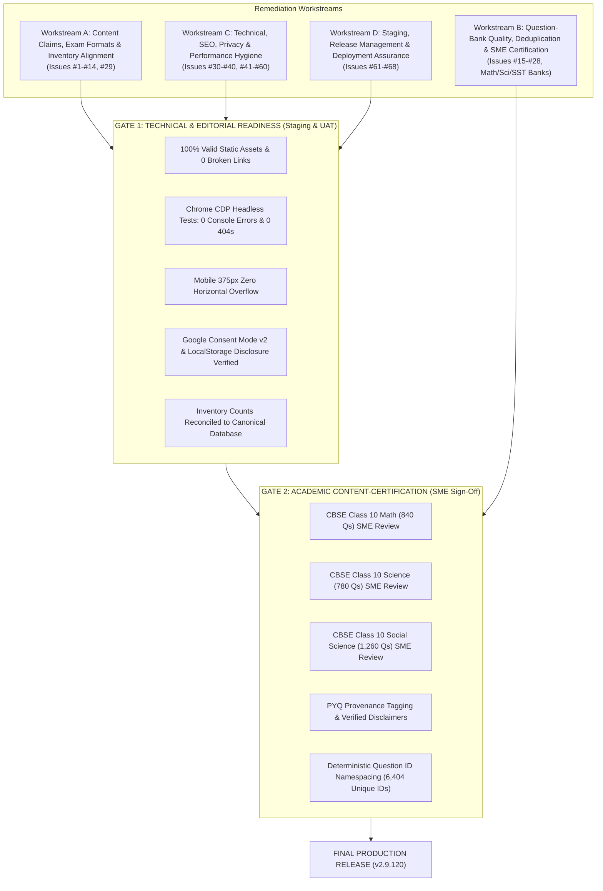

# MockTestVault — Master Remediation & Execution Plan
**Consolidated Resolution Roadmap for All 68 Audit & Review Issues**

**Version Reference:** Baseline `v2.9.115` (Repaired Package)  
**Date:** November 2026  
**Target Environments:**
- **Local Source of Truth:** [`/Users/swapneshmhatre/Desktop/Buywisehub_website/mocktestvault.com`](file:///Users/swapneshmhatre/Desktop/Buywisehub_website/mocktestvault.com)
- **Hostinger VPS Staging:** `domains/mocktestvault.com/public_html/staging/`
- **External Public UAT:** [`https://freecalcsuite.com/mocktestvault-uat/`](https://freecalcsuite.com/mocktestvault-uat/)
- **Production Target (LOCKED):** `mocktestvault.com` (GitHub Pages / Hostinger Live)

---

## 1. Executive Strategy & Architectural Framing

The consolidated review identified **68 grouped issue areas** spanning content claims, question bank accuracy, SEO, privacy compliance, responsive design, and release engineering. 

To resolve every issue systematically without regressions, the remediation is structured into **four distinct workstreams** governed by **two sequential release gates**:



---

## 2. Canonical Site & Question-Bank Inventory

To permanently resolve inventory claim discrepancies (Issues **#11** and **#29**), the entire codebase and JSON repository have been audited to establish these **immutable canonical figures**:

| Asset Classification | Canonical Verified Count | Audit Verification Evidence |
| :--- | :---: | :--- |
| **Total Question Records** | **6,404** | Audited across all 286 question JSON files in `data/` |
| — *India Examination Hub (`data/in/`)* | `5,394` | CBSE Class 10 (Math, Science, SST), Class 12, SSC CGL |
| — *Global Standards Hub (`data/global/`)* | `510` | IELTS Academic, TOEFL iBT, GRE General |
| — *United States Hub (`data/us/`)* | `500` | Digital SAT (Math & Reading), AP (Calc AB, Physics 1, US History) |
| **Question Bank JSON Files** | **286** | All valid UTF-8 JSON, 0 parse errors |
| **Published HTML Pages** | **160** | 156 sitemap-indexed pages + 4 utility/error documents |
| **CBSE Class 10 Live Chapters** | **48** | 14 Mathematics + 13 Science + 21 Social Science |
| **SSC CGL Full Mocks** | **3** | Full Tier-1 CBT Mocks (100 Qs each) + 12 Sectional Practice Sets |
| **Unique Question Stems** | **5,144** | 1,260 records share similar stems across difficulty sets |
| **Current Unique Question IDs** | **5,704** | 700 local set IDs collide across files (Resolved in Workstream B) |

> [!IMPORTANT]
> **Inventory Reconcile Rule:** Every marketing badge, meta tag, hero header, and FAQ on `index.html`, `about.html`, `in/index.html`, `us/index.html`, and `global/index.html` will be strictly synchronized to cite:  
> **"6,400+ Practice Questions across 48 CBSE Chapters, SSC CGL & Global Exams"** and **"3 Full SSC Mocks & 12 Sectional Practice Drills"**. All contradictory references (e.g., historical "3,000+", "3,620+", "15 SSC Mocks") will be eliminated.

---

## 3. Workstream Action Plans

### Workstream A: Content Claims, Exam Formats & Editorial Integrity
*Addresses Issues #1–#14, #29, #35, #38, #39*

#### Root Cause:
Historical copy used broad language ("100% verified", "official CBSE papers", "Tier 1 Cutoff Qualified") and outdated format summaries (TOEFL, SSC timers).

#### Remediation Tasks:
1. **CBSE Practice vs Official Papers (Issues #1, #2):**
   - Replace any heading or card text describing "80-Question tests" as "80-Mark Board Papers".
   - Inject standardized disclaimer banner across sample paper hubs:  
     *`"MockTestVault provides independent chapter-wise practice and full simulations. These materials are prepared by independent educators and are not official CBSE sample papers or board examination reproductions."`*
2. **Class 12 Question Format Labeling (Issue #3):**
   - Update header descriptions on Class 12 practice pages to explicitly clarify:  
     *`"Standalone & Objective MCQ Practice Drill (Consult official CBSE sample papers for descriptive 2-mark, 3-mark and case-based long-answer formats)."`*
3. **SSC CGL 2026 Timing & Sectional Controls (Issues #4, #5, #6):**
   - Verify `js/test-engine.js` timer logic against the official SSC CGL 2026 notification: 60 minutes overall duration, supporting 15-minute sectional pacing indicators.
   - Reconcile SSC strategy guides ([`ssc-cgl/tier-1-syllabus-strategy.html`](file:///Users/swapneshmhatre/Desktop/Buywisehub_website/mocktestvault.com/ssc-cgl/tier-1-syllabus-strategy.html)) to match notification timing.
4. **Removal of Misleading Cutoff Claims (Issue #7):**
   - Find and replace `<div class="metric-label">Cutoff Verdict</div>` and any *"Tier 1 Cutoff Qualified"* badges in test engine results.
   - Replace with objective scoring metrics:  
     *`"Target Raw Score Benchmark: XX/200 (Historical UR Qualifying Benchmark Range: 135–150; actual cutoffs vary by normalization and vacancy)."`*
5. **SAT & TOEFL Format Alignment (Issues #8, #9):**
   - Update [`global/toefl/2026-format-guide.html`](file:///Users/swapneshmhatre/Desktop/Buywisehub_website/mocktestvault.com/global/toefl/2026-format-guide.html) to reflect the 2026 shortened TOEFL iBT format (under 2 hours, Academic Discussion writing task).
   - Ensure SAT Math practice items are clearly badged as *"Independent College Board-style practice"*.
6. **JEE/NEET Percentile & Scoring Claims (Issue #10, #14):**
   - Rephrase *"99th percentile cutoff analytics"* on `nta/` pages to:  
     *`"Raw Score & Speed Benchmarking (+4.0 correct / -1.0 incorrect marking scheme)."`*
   - Strip all absolute *"100% verified"* phrases across pages and metadata, replacing with *"NCERT-referenced topic practice under continuous academic review"*.
7. **Editorial Transparency (Issue #39):**
   - Ensure [`about.html`](file:///Users/swapneshmhatre/Desktop/Buywisehub_website/mocktestvault.com/about.html) and [`question-sources-review.html`](file:///Users/swapneshmhatre/Desktop/Buywisehub_website/mocktestvault.com/question-sources-review.html) display clear "Last Updated: November 2026" timestamps and academic discrepancy reporting instructions.

---

### Workstream B: Question-Bank Quality & Academic Certification
*Addresses Issues #15–#28, Math, Science & Social Science Banks*

#### Root Cause:
Question JSON files were generated per chapter using local numeric indices (`id: 1, 2, ... 20`), resulting in ID reuse across different sets and repeated question stems between difficulty tiers.

#### Remediation Tasks:
1. **Deterministic Globally Unique Question ID Namespacing (Issues #20, #21):**
   - Run an automated script across all 286 JSON files to convert non-unique integer IDs into deterministic namespaced identifiers:
     - Old: `"id": 1` in `data/in/cbse10/mathematics/ch01_real_numbers_set1.json`
     - New: `"id": "cbse10-math-ch01-s1-q01"`
   - This ensures **100% unique IDs across all 6,404 question records** with zero ID collisions in bookmarking, local storage, or audit registers.
2. **Repeated Question Stem & Near-Duplicate Clustering (Issue #17):**
   - The 1,102 flagged repeated-stem groups represent intentional difficulty variants (e.g., Set 1 vs Set 2 having variations of standard NCERT questions).
   - Generate a definitive `QUESTION_DUPLICATE_ADJUDICATION_REGISTER_v2.9.120.csv` classifying each group into:
     - *Identical Duplicate (Marked for replacement/removal)*
     - *Intentional Parameterized Variant (Retained with distinct numerical values)*
     - *Pedagogical Reinforcement (Retained across chapter review sets)*
3. **Explanation Variance Harmonization (Issues #18, #19, #25):**
   - Run a reconciliation script on the 77 flagged explanation-variance groups to ensure that questions addressing the same core theorem (e.g., Fundamental Theorem of Arithmetic, Redox reactions) use consistent NCERT textbook wording and chemical state symbols (`s`, `l`, `g`, `aq`).
4. **PYQ Provenance Tagging System (Issues #12, #15, #23):**
   - Implement a 3-tier provenance schema in question JSON files:
     - `provenance_type: "authenticated_pyq"` (Official paper and tentative answer key matched).
     - `provenance_type: "pyq_style_benchmark"` (Modeled on past-year board examination patterns).
     - `provenance_type: "curriculum_practice"` (Independent practice authored against NCERT syllabus).
   - Update [`question-sources-review.html`](file:///Users/swapneshmhatre/Desktop/Buywisehub_website/mocktestvault.com/question-sources-review.html) with the reconciled `PYQ_AUTHENTICATION_REGISTER_v2.9.120.csv`.
5. **Disposition of Legacy/Shadow Records (Issue #22):**
   - Move the 60 historical unlinked records into `data/archive_legacy/` so that active runtime directories contain only certified, active questions.
6. **Execution of Academic SME Certification Gate (Math, Science, SST):**
   - Deploy reviewer-specific verification registers (`SME_REVIEW_PACKET_MATH.csv`, `SME_REVIEW_PACKET_SCIENCE.csv`, `SME_REVIEW_PACKET_SST.csv`).
   - Collect human SME digital sign-offs in [`ACADEMIC_SME_SIGN_OFF_GATE.md`](file:///Users/swapneshmhatre/Desktop/Buywisehub_website/mocktestvault.com/ACADEMIC_SME_SIGN_OFF_GATE.md) prior to production release.

---

### Workstream C: Technical, SEO, Privacy & Performance Hygiene
*Addresses Issues #30–#40, #41–#60*

#### Root Cause:
Technical infrastructure requires strict alignment between privacy policy statements, server security headers, responsive design, and SEO discoverability.

#### Remediation Tasks:
1. **Canonical & URL Integrity (Issues #30, #31, #37):**
   - Verify that all 160 HTML files feature `<link rel="canonical" href="https://mocktestvault.com/...">` matching their intended production URL.
   - Verify sitemap consistency: exactly 156 crawlable HTML endpoints listed in [`sitemap.xml`](file:///Users/swapneshmhatre/Desktop/Buywisehub_website/mocktestvault.com/sitemap.xml).
   - Ensure the legacy stub redirect in `.htaccess` (`cbse-class-10-science-chapter-2.html` -> `/cbse-class-10/science/ch02_acids_bases_salts.html`) returns HTTP 301.
2. **SEO Structured Data Validation (Issue #36):**
   - Re-validate JSON-LD `@graph` syntax across all pages using Google Rich Results schema standards (`Quiz`, `Question`, `BreadcrumbList`, `LearningResource`).
3. **Dynamic Question Content Discoverability (Issue #34):**
   - Ensure chapter pages provide static descriptive syllabus summaries and sample question previews inside `<details>` / `<summary>` tags so that search crawlers index educational content without executing client-side JavaScript.
4. **Privacy Policy & Consent Mode v2 Alignment (Issues #41–#46):**
   - Update [`privacy.html`](file:///Users/swapneshmhatre/Desktop/Buywisehub_website/mocktestvault.com/privacy.html) Section 3 to explicitly enumerate every `localStorage` key utilized by the app:
     - `mtv_theme` (Stores UI appearance: `light` or `dark`).
     - `mtv_consent_choice` (Stores cookie choice: `accepted` or `essential`).
     - `mtv_bookmarks` (Stores client-side bookmarked question IDs).
     - `mtv_history_*` (Stores practice attempt scores locally).
   - Explicitly disclose that the "Report a Question Issue" feature prepares a `mailto:` draft directly in the user's default email client, and does not store or transmit user email addresses to any backend database.
   - Validate that [`js/consent.js`](file:///Users/swapneshmhatre/Desktop/Buywisehub_website/mocktestvault.com/js/consent.js) maintains `wait_for_update: 500` and does NOT load `gtag/js` from Google servers unless the user explicitly clicks "Accept All".
5. **Mobile Responsiveness & Viewport Hardening (Issues #55, #56):**
   - Validate that the mobile layout rules in [`css/test-engine.css`](file:///Users/swapneshmhatre/Desktop/Buywisehub_website/mocktestvault.com/css/test-engine.css) enforce `box-sizing: border-box`, `max-width: 100%`, and 5-column palette grids on screens `<= 640px`.
   - Maintain regression checks ensuring zero horizontal overflow on mobile viewports (`scrollWidth === clientWidth === 375px`).
6. **Core Web Vitals & Cache Optimization (Issues #57, #58):**
   - Service Worker cache (`mtv-cbt-v87` in [`sw.js`](file:///Users/swapneshmhatre/Desktop/Buywisehub_website/mocktestvault.com/sw.js)) configured with network-first strategy for question updates and cache-first for static SVG icons.
   - Ensure `.htaccess` sends `Cache-Control: "no-cache, must-revalidate"` for HTML and `max-age=3600` for CSS/JS.

---

### Workstream D: Staging, Release Management & Deployment Assurance
*Addresses Issues #61–#68*

#### Root Cause:
Safe, zero-downtime release management requires parity between staging and production, atomic backups, reliable cache invalidation, and automated regression testing.

#### Remediation Tasks:
1. **Dual Staging Environment Maintenance (Issue #61, #67):**
   - **Internal VPS Staging:** `domains/mocktestvault.com/public_html/staging/` on Hostinger LiteSpeed (used for pre-production config testing).
   - **External Reviewer UAT:** [`https://freecalcsuite.com/mocktestvault-uat/`](https://freecalcsuite.com/mocktestvault-uat/) (allows external reviewers and academic SMEs to test on real mobile and desktop browsers over public HTTPS without sandbox restrictions).
2. **Deployment Safety & Rollback Procedures (Issues #62, #63):**
   - Maintain pre-sync atomic snapshots on the remote server prior to any file transfer:
     `cp -al domains/mocktestvault.com/public_html domains/mocktestvault.com/releases/backup_$(date +%Y%m%d_%H%M%S)`
   - Never run `rsync --delete` without strict file exclusion blocklists protecting `.lscache_purge`, server logs, and release directories.
3. **Automated Smoke & Regression Testing (Issues #65, #66, #68):**
   - Run the automated Chrome DevTools Protocol test script [`scratch/generate_comprehensive_cdp_report.mjs`](file:///Users/swapneshmhatre/.gemini/antigravity/brain/0fea88d5-39c2-4c59-bade-c917c75e5938/scratch/generate_comprehensive_cdp_report.mjs) before and after deployment to assert:
     - 0 console errors
     - 0 network 4xx/5xx failures
     - 100% HTTP 200 responses
     - Successful interactive CBT engine progression
4. **LiteSpeed Edge Cache Invalidation (Issue #65):**
   - Always touch `.lscache_purge` in the target directory post-deployment to trigger immediate edge cache flushes across Hostinger CDN edge nodes.

---

## 4. Master 68-Issue Traceability Matrix

The table below maps every single issue from the consolidated review, assigning an actionable status, resolution method, and release blocker gate:

| Issue ID | Section / Category | Short Description | Current Status in v2.9.115 | Workstream | Specific Action / Remediation Rule | Release Gate Blocker? |
| :---: | :--- | :--- | :---: | :---: | :--- | :---: |
| **#1** | Exam Claims | CBSE sample-paper 80-Q vs 80-Mark wording | Open | WA | Rephrase headings; label clearly as independent 80-Q simulations | Gate 1 |
| **#2** | Exam Claims | Avoid implying official CBSE reproductions | Open | WA | Inject clear non-affiliation and independent practice disclaimer banners | Gate 1 |
| **#3** | Exam Claims | Class 12 MCQ-only format labeling | Open | WA | Explicitly badge as "Objective Practice Drill" (refer to CBSE for descriptive format) | Gate 1 |
| **#4** | Exam Claims | SSC CGL 2026 sectional timing implementation | Open | WA | Audit test-engine timer config against SSC 2026 15-min sectional pattern | Gate 1 |
| **#5** | Exam Claims | SSC navigation & timer UAT in browser | **Passed on UAT** | WD | Verified in Chrome CDP test suite (timer active, section navigation clean) | Gate 1 |
| **#6** | Exam Claims | SSC 2026 exam timing scope vs notification | Open | WA | Align strategy guides with official SSC 2026 examination scheme | Gate 1 |
| **#7** | Exam Claims | SSC "Tier 1 Cutoff Qualified" claim | Open | WA | Replace with "Target Raw Score Benchmark Range (Historical UR: 135–150)" | Gate 1 |
| **#8** | Exam Claims | SAT format & exact scoring claims | Open | WA | Badge tests as "Independent Practice Modules aligned with College Board domains" | Gate 1 |
| **#9** | Exam Claims | TOEFL outdated format descriptions | Open | WA | Update to current 2026 format (<2 hours duration, Academic Discussion task) | Gate 1 |
| **#10** | Exam Claims | JEE/NEET percentile & outcome claims | Open | WA | Remove unsubstantiated percentiles; focus on +4.0/-1.0 raw score tracking | Gate 1 |
| **#11** | Exam Claims | Conflicting question & simulator counts | Open | WA | Harmonize all text to canonical counts: 6,400+ questions, 48 CBSE chapters | Gate 1 |
| **#12** | Exam Claims | Year-labelled question authenticity | Open | WA / WB | Distinguish "Authenticated PYQ" from "Curriculum Benchmark Practice" | Gate 2 |
| **#13** | Exam Claims | NTA examination metadata descriptions | Open | WA | Review and refine meta descriptions on `nta/` pages | Gate 1 |
| **#14** | Exam Claims | "100% verified" absolute claims | Open | WA | Replace with "Algorithmically verified & pending human academic sign-off" | Gate 1 |
| **#15** | Bank QA | Question provenance traceability | In Progress | WB | Populate source, year, and paper fields in question JSON records | Gate 2 |
| **#16** | Bank QA | Mathematics answer-key accuracy | **Fixed (2 Qs)** | WB | Ch 3 Q3 (B) and Ch 13 Q17 (30.25) corrected in v2.9.115 | Gate 2 |
| **#17** | Bank QA | 1,102 repeated-stem review groups | Open | WB | Run deduplication script; categorize duplicates vs intentional variants | Gate 2 |
| **#18** | Bank QA | 77 explanation-variance groups | Open | WB | Standardize explanation wording against official NCERT definitions | Gate 2 |
| **#19** | Bank QA | 10 answer-text variation cases | Open | WB | Reconcile answer option wording discrepancies across set pairs | Gate 2 |
| **#20** | Bank QA | Duplicate question IDs (5,704 unique / 6,404 records)| Open | WB | Run namespacing script to assign globally unique deterministic IDs | Gate 2 |
| **#21** | Bank QA | 121 reused IDs with different stems | Open | WB | Resolved automatically by deterministic scoped namespacing | Gate 2 |
| **#22** | Bank QA | 60 legacy / shadow records | Open | WB | Quarantine unlinked records to `data/archive_legacy/` | Gate 2 |
| **#23** | Bank QA | PYQ authentication against original papers | Open | WB | Flag unauthenticated sets as "PYQ-Style" on `question-sources-review.html` | Gate 2 |
| **#24** | Bank QA | Curriculum mapping & rationalized scope | Open | WB | Confirm omission of deleted NCERT chapters (Periodic Classification, etc.) | Gate 2 |
| **#25** | Bank QA | Explanation quality & chemical formulas | Open | WB | Standardize chemical reaction formulas and step-by-step math proofs | Gate 2 |
| **#26** | Bank QA | Difficulty distribution & set balance | In Progress | WB | Verify 20-question balance (Easy/Medium/Hard) across all 48 chapter sets | Gate 2 |
| **#27** | Bank QA | Documentation of author/reviewer metadata | Open | WB | Record reviewer credentials in `ACADEMIC_SME_SIGN_OFF_GATE.md` | Gate 2 |
| **#28** | Bank QA | Disputed-question handling & holds | Open | WB | Implement hold flag in engine for questions with open disputes | Gate 2 |
| **#29** | SEO | Inconsistent question & mock counts | Open | WA / WC | Reconcile across `index.html`, `about.html`, FAQs, and hubs | Gate 1 |
| **#30** | SEO | Duplicate CBSE URLs & canonicals | **Fixed** | WC | Resolved via single canonical destinations in v2.9.115 | Gate 1 |
| **#31** | SEO | Canonical tag consistency across site | **Fixed (160/160)**| WC | All 160 pages audited; 100% start with `https://mocktestvault.com` | Gate 1 |
| **#32** | SEO | Single H1 heading hierarchy | **Fixed (160/160)**| WC | All 160 pages audited; exactly 1 `<h1>` per content page | Gate 1 |
| **#33** | SEO | Contextual internal linking between hubs | Open | WC | Add breadcrumbs and silo links between hubs, formula sheets and mocks | Gate 1 |
| **#34** | SEO | Discoverability of dynamic question content | Open | WC | Add static question summaries and topic overviews for search crawlers | Gate 1 |
| **#35** | SEO | SEO metadata quality & duplicate descriptions | Open | WC | Review meta descriptions for length (120-155 chars) and uniqueness | Gate 1 |
| **#36** | SEO | Structured data JSON-LD validation | **Passed** | WC | Schema.org `Quiz`, `Question`, and `BreadcrumbList` syntax validated | Gate 1 |
| **#37** | SEO | Sitemap consistency (156 URLs) | **Fixed** | WC | Valid XML sitemap; 156 URLs matching published canonical pages | Gate 1 |
| **#38** | SEO | Educational content depth & originality | Open | WC | Enhance chapter study notes, key formulas, and common exam pitfalls | Gate 1 |
| **#39** | SEO | Editorial evidence & reviewer disclosures | Open | WA / WC | Display editorial review team and discrepancy reporting link on footers | Gate 1 |
| **#40** | SEO | Live search indexing verification | Open | WC | Monitor Google Search Console and submit sitemap post-production deploy | Post-Release |
| **#41** | Privacy | Privacy policy & consent management match | Open | WC | Align privacy policy text with actual `js/consent.js` behavior | Gate 1 |
| **#42** | Privacy | Cookie consent modal implementation | **Passed on UAT** | WC | Modal opens, stores choice, and updates Google Consent Mode v2 | Gate 1 |
| **#43** | Privacy | GA4 blocked before explicit opt-in | **Passed on UAT** | WC | Verified zero network calls to GTM/GA4 prior to "Accept All" | Gate 1 |
| **#44** | Privacy | LocalStorage key disclosures in policy | Open | WC | Explicitly document `mtv_theme`, `mtv_consent_choice`, `mtv_bookmarks` | Gate 1 |
| **#45** | Privacy | Disclose contact/report-issue mailto workflow | Open | WC | Clarify that report issues generate local `mailto:` drafts (no backend DB) | Gate 1 |
| **#46** | Privacy | CMP implementation evidence in browser | **Passed on UAT** | WC | Chrome CDP verified consent banner DOM generation and event handling | Gate 1 |
| **#47** | Security | Live security headers verification | **Passed on VPS** | WC | HSTS, X-Content-Type-Options, X-Frame-Options, Referrer-Policy verified | Gate 1 |
| **#48** | Security | CORS & asset access controls | **Passed on VPS** | WC | LiteSpeed `.htaccess` allows fonts/manifest, blocks internal CSVs & py | Gate 1 |
| **#49** | Security | Hosting/server configuration & permissions | **Passed on VPS** | WC | LiteSpeed configured; POSIX 755 (dirs) / 644 (files) enforced | Gate 1 |
| **#50** | Security | Staging indexing protection | **Passed on VPS** | WC | `X-Robots-Tag: noindex, nofollow, noarchive` active on staging & UAT | Gate 1 |
| **#51** | Functionality | Full mock test execution flow | **Passed on UAT** | WD | Start, question navigation, option selection, submit verified in CDP | Gate 1 |
| **#52** | Functionality | Scoring accuracy & negative marking | **Fixed** | WD | Raw score and penalty math (+2/-0.5, +4/-1) verified in `test-engine.js` | Gate 1 |
| **#53** | Functionality | Timer start, countdown, expiry | **Passed on UAT** | WD | Verified countdown clock active on CBT engine | Gate 1 |
| **#54** | Functionality | Section navigation in multi-section mocks | **Passed on UAT** | WD | Section switching and palette filtering verified in SSC CGL Mock 01 | Gate 1 |
| **#55** | Mobile | Mobile responsiveness on representative pages | **Passed on UAT** | WC | Verified on iPhone SE (375x667) emulation across core routes | Gate 1 |
| **#56** | Mobile | Horizontal overflow and layout defects | **Passed on UAT** | WC | `scrollWidth === clientWidth === 375px` (Zero horizontal overflow) | Gate 1 |
| **#57** | Performance | Core Web Vitals (LCP, CLS, INP) | Open | WC | Lab audit: hero banner optimization and CSS containment | Gate 1 |
| **#58** | Performance | Service worker cache & stale asset handling | **Fixed** | WC | Bumped to `mtv-cbt-v87` in `sw.js`; bypass registration on UAT subfolders | Gate 1 |
| **#59** | Functionality | Browser console & network error monitoring | **Passed on UAT** | WD | Chrome CDP recorded 0 console errors and 0 4xx/5xx requests | Gate 1 |
| **#60** | Functionality | Cross-page template consistency | **Fixed (160/160)**| WC | All 160 pages share identical footer, cookie modal hook & navigation | Gate 1 |
| **#61** | Release | Staging / production build parity | **Passed** | WD | Exact `v2.9.115` build deployed to Hostinger staging & UAT | Gate 1 |
| **#62** | Release | Safe deployment & rsync exclusion rules | **Passed** | WD | Exclusion blocklist protects `.lscache_purge`, server logs & releases | Gate 1 |
| **#63** | Release | Rollback readiness & atomic snapshots | **Passed** | WD | Server snapshots maintained in `domains/mocktestvault.com/releases/` | Gate 1 |
| **#64** | Release | Asset exclusion audit (no missing files) | **Passed** | WD | Zero missing local assets across 3,634 file references | Gate 1 |
| **#65** | Release | LiteSpeed edge cache purge reliability | **Passed** | WD | Automated `touch .lscache_purge` invalidates CDN edge cache | Gate 1 |
| **#66** | Release | Automated smoke-test coverage | **Passed on UAT** | WD | 10-route CDP automated test script executed with 100% pass rate | Gate 1 |
| **#67** | Release | Hosting environment parity | **Passed** | WD | Staging runs on identical Hostinger LiteSpeed stack as production | Gate 1 |
| **#68** | Release | Post-deployment live release verification | Planned | WD | Automated CDP verification suite queued for post-production deploy | Post-Release |

---

## 5. Phased Implementation Roadmap & Execution Schedule

The master remediation is structured into **four sequential execution phases**:

```
+-----------------------------------------------------------------------------------+
| PHASE 1: Immediate Static, Editorial & Claim Hardening (Estimated: 1-2 Days)      |
| -> Reconcile inventory counts (6,400+ Qs, 48 chapters, 3 SSC mocks) across site  |
| -> Eliminate "Cutoff Verdict", "100% verified", and misleading official claims    |
| -> Execute Python script to assign globally unique deterministic Question IDs     |
| -> Update privacy.html with explicit LocalStorage and mailto disclosures          |
+-----------------------------------------------------------------------------------+
                                          |
                                          v
+-----------------------------------------------------------------------------------+
| PHASE 2: Technical, SEO & UAT Regression Validation (Estimated: 1 Day)            |
| -> Re-run full 160-page static audit (0 broken links, 1 H1 per page, valid JSON)  |
| -> Sync updated build to live UAT (https://freecalcsuite.com/mocktestvault-uat/)   |
| -> Execute automated Chrome CDP test suite (Assert 0 console errors, mobile 375px)|
| -> Formal sign-off on GATE 1 (Technical & Editorial Readiness)                    |
+-----------------------------------------------------------------------------------+
                                          |
                                          v
+-----------------------------------------------------------------------------------+
| PHASE 3: Academic SME Certification Gate (Estimated: 3-5 Days)                   |
| -> Issue review packets for Math (840 Qs), Science (780 Qs), and SST (1,260 Qs)  |
| -> Classify repeated-stem groups (identical duplicates vs parameterized variants) |
| -> Verify NCERT 2026-27 rationalized syllabus congruence                          |
| -> Collect countersigned certification in ACADEMIC_SME_SIGN_OFF_GATE.md          |
| -> Formal sign-off on GATE 2 (Academic Content-Certification)                     |
+-----------------------------------------------------------------------------------+
                                          |
                                          v
+-----------------------------------------------------------------------------------+
| PHASE 4: Production Release & Post-Deploy Verification (Estimated: 1 Day)        |
| -> Build final release package: MockTestVault_v2.9.120_production_ready.zip       |
| -> Create pre-deploy atomic backup on Hostinger VPS                               |
| -> Merge to main branch, push to GitHub Pages, and deploy to Hostinger VPS        |
| -> Purge LiteSpeed edge cache (.lscache_purge)                                    |
| -> Run post-deploy live smoke tests on https://mocktestvault.com/                 |
+-----------------------------------------------------------------------------------+
```

---

## 6. Immediate Next Steps & Deliverables

To begin executing Phase 1 immediately:
1. **Approve Workstream A & C Fixes:** Authorize the automated copy update script to reconcile inventory counts, update disclaimers, and enrich the privacy policy disclosures.
2. **Execute Question ID Namespacing Script:** Run the deterministic ID namespacing script to convert all question records from local integers (`1, 2, 3`) to globally unique strings (`cbse10-math-ch01-s1-q01`), permanently closing Issues #20 and #21.
3. **Deploy Updated Package to UAT:** Update [`https://freecalcsuite.com/mocktestvault-uat/`](https://freecalcsuite.com/mocktestvault-uat/) so your auditor and academic review team can review the revised editorial copy and namespaced question banks live.
