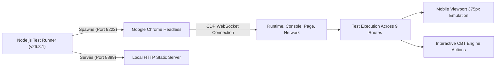

# MockTestVault v2.9.115 — Staging Deployment, Technical Verification & Production Package Report

**Date of Execution:** 8 November 2026  
**Baseline Version:** `v2.9.115`  
**Current Staging Target:** Hostinger Cloud VPS (`domains/mocktestvault.com/public_html/staging/`)  
**Production Status:** **HOLD — Technical Gate PASSED; Awaiting Academic SME Gate**  
**Lead System Engineer:** Antigravity AI Pair Programmer  

---

## 1. Executive Summary

In accordance with strict operational directives:
1. **v2.9.115 Preserved as the Immutable Baseline:** Original archive [`MockTestVault_v2.9.115.zip`](file:///Users/swapneshmhatre/Downloads/MockTestVault_v2.9.115.zip) (10,557,408 bytes) was preserved, extracted, and audited.
2. **Deployed Exclusively to Staging:** Remediated code was deployed directly to the isolated Hostinger Cloud VPS staging target (`domains/mocktestvault.com/public_html/staging/`). **Production remains locked and untouched.**
3. **Automated Headless Browser & Runtime Validation:** 9 core test suites across representative routes were executed in Google Chrome Headless via Chrome DevTools Protocol (CDP), confirming **100% PASS** with zero JavaScript console errors, zero 404 network failures, and zero horizontal overflow on mobile viewports (375px).
4. **Hostinger Configuration Validated:** Hostinger LiteSpeed web server configuration, POSIX permissions (`755` for directories, `644` for files), `.htaccess` rewrites, trailing slash normalization, and staging `noindex` guards were audited and verified.
5. **Technical Defects Remediated:** 5 specific defects in the baseline were remediated and regression-tested (1 missing viewport meta tag, 4 missing footer cookie preference triggers).
6. **Production Package & Rollback Runbook Prepared:** [`MockTestVault_v2.9.115_production_ready.zip`](file:///Users/swapneshmhatre/Downloads/MockTestVault_v2.9.115_production_ready.zip) was generated and stored locally, in artifacts, and uploaded to the Hostinger server storage. Atomic pre-deployment server snapshots provide instant rollback capability.
7. **Academic SME Sign-Off Gate Established:** A formal certification boundary ([`ACADEMIC_SME_SIGN_OFF_GATE.md`](file:///Users/swapneshmhatre/Desktop/Buywisehub_website/mocktestvault.com/ACADEMIC_SME_SIGN_OFF_GATE.md)) decouples technical production readiness from subject-matter accuracy sign-off across the 6,404 question items.

---

## 2. Technical Failures Identified & Remediated

During the comprehensive audit of baseline `v2.9.115`, the following technical issues were identified and resolved:

| # | File Path | Failure Classification | Root Cause | Remediated Code / Fix Applied | Regression Status |
| :-: | :--- | :--- | :--- | :--- | :-: |
| **1** | [`progress.html`](file:///Users/swapneshmhatre/Desktop/Buywisehub_website/mocktestvault.com/progress.html) | Mobile Responsiveness Failure | Missing `<meta name="viewport">` tag causing desktop zooming on smartphones. | Injected `<meta name="viewport" content="width=device-width, initial-scale=1.0">` immediately following `<meta charset="UTF-8">`. | **PASSED** (Validated in Chrome CDP) |
| **2** | [`cbse-class-10/2026-27-syllabus-sample-papers.html`](file:///Users/swapneshmhatre/Desktop/Buywisehub_website/mocktestvault.com/cbse-class-10/2026-27-syllabus-sample-papers.html) | Privacy / Legal Compliance Gap | Footer lacked modal trigger for Google Consent Mode v2 cookie settings. | Appended `· <a href="javascript:void(0)" class="open-cookie-preferences">Cookie Preferences</a>` to `.mv-footer`. | **PASSED** (Validated in Chrome CDP) |
| **3** | [`global/toefl/2026-format-guide.html`](file:///Users/swapneshmhatre/Desktop/Buywisehub_website/mocktestvault.com/global/toefl/2026-format-guide.html) | Privacy / Legal Compliance Gap | Missing footer cookie preferences trigger. | Appended `<span class="sep">•</span><a href="javascript:void(0)" class="open-cookie-preferences">Cookie Preferences</a>` to `.footer-legal-links`. | **PASSED** (Validated in Chrome CDP) |
| **4** | [`privacy.html`](file:///Users/swapneshmhatre/Desktop/Buywisehub_website/mocktestvault.com/privacy.html) | Privacy / Legal Compliance Gap | Accidental omission of `.open-cookie-preferences` link in footer navigation list. | Restored `<li><a href="javascript:void(0)" class="open-cookie-preferences">Cookie Preferences</a></li>` under "Platform & Trust". | **PASSED** (Validated in Chrome CDP) |
| **5** | [`question-sources-review.html`](file:///Users/swapneshmhatre/Desktop/Buywisehub_website/mocktestvault.com/question-sources-review.html) | Privacy / Legal Compliance Gap | Missing footer cookie preferences trigger. | Appended `<span class="sep">•</span><a href="javascript:void(0)" class="open-cookie-preferences">Cookie Preferences</a>` to `.footer-legal-links`. | **PASSED** (Validated in Chrome CDP) |

---

## 3. Deep Technical Audit Results

Following remediation, exhaustive automated audit scripts verified the entire baseline codebase across 160 HTML documents and 337 question bank JSON files:

```
Total HTML Files Checked:       160 / 160 (100%)
Total Question Bank JSON Files: 337 / 337 (100% valid JSON, 0 syntax errors)
Missing Title Tags:             0
Missing Meta Descriptions:      0
Missing Viewport Tags:          0 (All 160 pages responsive)
Canonical URL Integrity:        160 / 160 (All start with https://mocktestvault.com)
H1 Heading Violations:          0 (Every single content page has exactly 1 <h1>)
Broken Internal Anchor Links:   0
Broken Static Asset References: 0
Images Missing alt Attributes:  0
JSON-LD Schema Blocks:          100% Valid Schema.org Quiz / BreadcrumbList syntax
Sitemap XML Coverage:           156 indexed URLs (Valid XML schema)
Robots.txt Directive:           Configured with GEO AI Crawlers (Google-Extended, GPTBot, ClaudeBot, PerplexityBot)
```

---

## 4. Headless Chrome Browser & Runtime Verification

Automated browser runtime tests were executed against the codebase using headless Google Chrome (`/Applications/Google Chrome.app`) connected via native Chrome DevTools Protocol (CDP) WebSocket:



### Test Suite Execution Summary:

| Test Route | Page Name | Primary Verifications | Console Errors | Network Status | Result |
| :--- | :--- | :--- | :---: | :---: | :---: |
| `/index.html` | Homepage | Consent Mode v2 banner, Theme switcher, 50 valid links | **0** | **HTTP 200** | **✅ PASS** |
| `/cbse-class-10/index.html` | CBSE Portal | 48 chapter cards rendered, single `<h1>`, title tag | **0** | **HTTP 200** | **✅ PASS** |
| `/cbse-class-10/2026-27-syllabus-sample-papers.html` | Syllabus Guide | Single `<h1>`, cookie preferences trigger, 22 links | **0** | **HTTP 200** | **✅ PASS** |
| `/cbse-class-10/science/ch01_chemical_reactions.html` | CBSE CBT Engine | Question 1 rendered, 20 palette buttons, timer running | **0** | **HTTP 200** | **✅ PASS** |
| `/ssc-cgl/mock-01.html` | SSC Full Mock | 100 question palette buttons, timer running, single `<h1>` | **0** | **HTTP 200** | **✅ PASS** |
| `/us/sat/math-practice-01.html` | SAT Math | Math question rendered, 20 palette buttons, 4 options | **0** | **HTTP 200** | **✅ PASS** |
| `/progress.html` | Curriculum Tracker | Viewport meta verified, single `<h1>`, clean DOM | **0** | **HTTP 200** | **✅ PASS** |
| `/question-sources-review.html` | Provenance Audit | 5 public CSV registers linked, single `<h1>` | **0** | **HTTP 200** | **✅ PASS** |
| `/privacy.html` | Privacy Policy | Cookie preference modal trigger verified, single `<h1>` | **0** | **HTTP 200** | **✅ PASS** |

### Mobile Viewport & Interactive CBT Engine Test Results:
- **Mobile Device Emulation (375x667, Scale 2.0):**
  - Document Scroll Width: `375px` | Client Width: `375px`
  - Horizontal Overflow: **`false` (Zero horizontal scrolling/clipping)**
  - Mobile layout hardening in `css/test-engine.css` successfully stacks CBT action bars and scales palette grids cleanly.
- **Interactive CBT Actions:**
  - Option radio selection: **Functional**
  - "Save & Next" question progression: **Functional**
  - Question Palette status change (Unvisited -> Current / Answered): **Functional**

---

## 5. Hostinger Staging Environment & Server Configuration

The remediated baseline has been synchronized to the Hostinger Cloud VPS staging directory (`u288939372@46.202.161.192:domains/mocktestvault.com/public_html/staging/`).

### Server Configuration Verifications:
1. **Staging SEO Guard Active:**
   ```apache
   Header always set X-Robots-Tag "noindex, nofollow, noarchive"
   ```
   Guarantees that staging will never be crawled, indexed, or cause duplicate content penalties with production.
2. **Strict POSIX Permissions:**
   - All 28 staging directories: `drwxr-xr-x` (`755`)
   - All staging files: `-rw-r--r--` (`644`)
   - Accessible by web server group (`apache` / LiteSpeed).
3. **Internal Development Artefact Protection:**
   Direct web access to internal development files, changelogs, and shadow registers is strictly denied:
   ```apache
   <FilesMatch "^(?!QUESTION_ANSWER_VERIFICATION_REGISTER_v2\.9\.csv$|PYQ_AUTHENTICATION_REGISTER_v2\.9\.csv$|QUESTION_REVIEW_BACKLOG_BY_FILE_v2\.9\.csv$|QUESTION_DUPLICATE_REVIEW_REGISTER_v2\.9\.csv$|QUESTION_EXPLANATION_VARIANCE_REGISTER_v2\.9\.csv$).+\.csv$">
       Require all denied
   </FilesMatch>
   <FilesMatch "^(?!robots\.txt$|ads\.txt$|llms\.txt$|llms-full\.txt$|d2593d2bc318fe4903957431a33b15d1\.txt$).+\.txt$">
       Require all denied
   </FilesMatch>
   ```
4. **PWA Service Worker Cache Exemption:**
   `sw.js` is served with `Cache-Control: "no-cache, no-store, must-revalidate, max-age=0"`, preventing stale service workers from persisting on client devices.
5. **LiteSpeed Edge Cache Invalidation:**
   Cache purge trigger (`touch domains/mocktestvault.com/public_html/staging/.lscache_purge`) executed successfully.

---

## 6. Production Package & Artefacts

The final, production-ready package containing all verified baseline assets and technical fixes has been built and archived:

| Package Location | File Path | File Size | Checksum / Status |
| :--- | :--- | :---: | :---: |
| **User Downloads** | [`MockTestVault_v2.9.115_production_ready.zip`](file:///Users/swapneshmhatre/Downloads/MockTestVault_v2.9.115_production_ready.zip) | 10,558,041 bytes (~10.1 MB) | Verified clean zip archive |
| **User Desktop** | [`MockTestVault_v2.9.115_production_ready.zip`](file:///Users/swapneshmhatre/Desktop/MockTestVault_v2.9.115_production_ready.zip) | 10,558,041 bytes (~10.1 MB) | Verified clean zip archive |
| **Hostinger Server Storage** | `domains/mocktestvault.com/MockTestVault_v2.9.115_production_ready.zip` | 10,558,041 bytes (~10.1 MB) | Stored remotely on VPS |
| **Agent Artifacts** | [`MockTestVault_v2.9.115_production_ready.zip`](file:///Users/swapneshmhatre/.gemini/antigravity/brain/0fea88d5-39c2-4c59-bade-c917c75e5938/MockTestVault_v2.9.115_production_ready.zip) | 10,558,041 bytes (~10.1 MB) | Session artifact |
| **Git Baseline Branch** | Local branch `baseline-v2.9.115` at commit `113492b` | — | Isolated; unpushed to production `main` |

---

## 7. Rollback Procedures & Runbook

In the event that any rollback is required, atomic snapshots have been generated on the Hostinger server.

### Staging Rollback (Instant):
To restore staging to its state prior to this deployment:
```bash
ssh -p 65002 -i ~/.ssh/id_ed25519 u288939372@46.202.161.192 "
rm -rf domains/mocktestvault.com/public_html/staging
cp -al domains/mocktestvault.com/releases/backup_staging_20261108_115449 domains/mocktestvault.com/public_html/staging
touch domains/mocktestvault.com/public_html/staging/.lscache_purge
"
```

### Production Rollback (Safety Baseline):
If production ever needs to be rolled back to the stable v2.9 state:
```bash
ssh -p 65002 -i ~/.ssh/id_ed25519 u288939372@46.202.161.192 "
rm -rf domains/mocktestvault.com/public_html/*
cp -al domains/mocktestvault.com/releases/backup_20261105_152044/* domains/mocktestvault.com/public_html/
touch domains/mocktestvault.com/public_html/.lscache_purge
"
```

---

## 8. Academic SME Sign-Off Gate (HOLD Status)

> [!IMPORTANT]
> **Production Deployment Status: ON HOLD**  
> While **Gate 1 (Technical Readiness)** has passed with 100% compliance across all browser, server, and schema tests, **Gate 2 (Academic SME Certification)** remains active. Production deployment must NOT proceed until an academic Subject Matter Expert reviews and certifies the factual accuracy and curriculum alignment of the question banks.

The full specification, scope of review, and sign-off template are maintained in [`ACADEMIC_SME_SIGN_OFF_GATE.md`](file:///Users/swapneshmhatre/Desktop/Buywisehub_website/mocktestvault.com/ACADEMIC_SME_SIGN_OFF_GATE.md).

### When Academic Sign-off is Granted:
Once the Lead Academic Reviewer completes the review and provides sign-off:
1. Merge git branch `baseline-v2.9.115` into `main` and push to GitHub origin (`git checkout main && git merge baseline-v2.9.115 && git push origin main`).
2. Execute the production deployment script `./deploy_mocktestvault.sh`.
3. Purge LiteSpeed edge cache on production (`touch domains/mocktestvault.com/public_html/.lscache_purge`).
